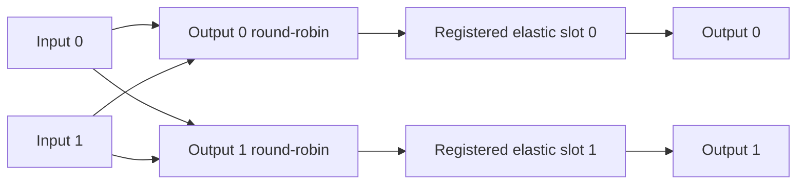

# multiport-packet-router-uvm

[繁體中文](README.zh-TW.md)

A 2-input, 2-output SystemVerilog packet router with a reusable Accellera UVM
2020.3.2 testbench. The project demonstrates ready/valid design, fair arbitration,
independent checking, functional coverage, assertions and deliberately faulty RTL
for ASIC/DV interview preparation.

All 25 directed RTL runs and 13 positive UVM runs passed. The tests hit all 21 functional coverage bins and detected all six injected RTL defects. [Verification report](reports/verification.md) · [CI run](https://github.com/ncusspm25/multiport-packet-router-uvm/actions/runs/44156314065)

## Reproduce from a clean checkout

Use Linux or Ubuntu 24.04 on WSL2. Run the following inside the Linux shell.
Python 3.12+ is needed for safe archive extraction. No Python packages are required.

```sh
sudo apt-get update
sudo apt-get install -y --no-install-recommends build-essential git python3 perl ca-certificates autoconf flex bison libfl-dev z3
git clone https://github.com/ncusspm25/multiport-packet-router-uvm.git
cd multiport-packet-router-uvm
python3 scripts/bootstrap_tools.py --jobs 2
make verify JOBS=2
```

The bootstrap script pins official **Verilator 5.054** and **UVM 2020.3.2** sources,
checks their identity/integrity, and writes an ignored `.tools/env.mk`. It builds
an optimized local simulator without replacing the system installation. The
Verilator source build and first UVM compilation take several minutes.

For WSL2, keeping the source/build trees in the Linux filesystem avoids mounted
Windows filesystem overhead. An external build directory is also supported.

```sh
make verify BUILD_DIR="$HOME/.cache/router-build" JOBS=2
```

## Router contract



- One accepted beat is one complete packet. `dest` selects output 0 or 1.
- `DATA_W` defaults to 32. RTL directed tests cover widths 1, 8, 16, 32 and 64.
- Each output has an independent round-robin arbiter and one registered slot.
- Arbitration priority advances only on input acceptance. Stalled outputs retain
  their payload and valid flag. A slot can dequeue and refill on the same edge.
- Forward latency is one cycle. Independent destinations can each transfer one
  packet per cycle after filling.
- Sources retain valid, data and destination until a handshake completes.
- Synchronous active-low reset clears both output slots and priorities. Buffered
  packets are counted as reset-aborted, with a new scoreboard epoch.
- Per-output FIFO order follows accepted inputs. Different outputs progress
  independently, so cross-output completion has no total ordering guarantee.

See [architecture and arbitration](docs/architecture.md) for signal-level rules.

## Verification structure

Each source agent contains a packet sequencer, driver and monitor. Sink agents
contain an independently configured ready responder and monitor. Active/passive
mode controls driver construction. Drivers change signals on falling edges, and
monitors sample rising edges before the RTL nonblocking updates.

Four analysis FIFOs synchronize per-port observations by cycle. The SystemVerilog
reference model builds expected queues from observed input handshakes and checks
output payload/order, routing, conservation, reset aborts and round-robin service.
It does not inspect DUT internal state. A separate Python FIFO oracle replays the
transfer CSV and checks every positive run independently.

Native covergroups contain explicit route, contention-grant, output-stall,
reset-during-traffic, payload-pattern and scenario bins. Scenario completion also
requires observed traffic conditions. SVA checks source/output stability,
synchronous reset clearing and exclusive grants under contention.

## Commands and evidence

| Command | What it executes |
| --- | --- |
| `make smoke` | Minimal full-UVM factory/phasing/objection smoke |
| `make features` | Actual randomization, virtual-interface and native coverage probe |
| `make directed DATA_W=32` | RTL single-port, simultaneous, contention, backpressure and reset checks |
| `make test CASE=single SEED=1` | One UVM case plus independent Python checking |
| `make test CASE=random SEED=17 N_PACKETS=512` | Reproducible constrained-random packet/ready traffic |
| `make test CASE=all SEED=1` | All seven scenarios in one covergroup instance |
| `make test CASE=stress SEED=1` | At least 5,000 packets per source and 10,000 clock cycles |
| `make regression` | Positive runs, same-seed replay, passive-agent check and expected negatives |
| `make coverage reports` | Native coverage merge and readable evidence reports |
| `make verify` | Ordered end-to-end acceptance workflow |

Supported `CASE` values are `single`, `simultaneous`, `contention`, `backpressure`,
`reset`, `random`, `stress`, `all` and the expected-negative `protocol_negative`.
`make test CASE=protocol_negative` intentionally fails a protocol assertion. Use
`make regression` to classify that failure as an expected detection.

The regression reruns random seed 17 and compares SHA-256 hashes of cycle-level
transfer traces. Seeds 1, 17 and 123 are explicit. A simulation process returning
zero is insufficient for acceptance. The log marker, UVM severity summary, JSON
result, independent Python replay and native coverage file must all be present.

The [executed simulation report](reports/verification.md),
[measured coverage](reports/coverage.md) and
[machine-readable results](reports/regression.json) record actual runs.
GitHub Actions executes the same clean-checkout workflow and uploads logs,
transfer traces and coverage artifacts.

## Mutation checks

`scripts/make_mutants.py` generates six named RTL variants in the build directory.
The production RTL remains the synthesis source. The mutation manifest records
the precise changed text and hashes. A test-only wrapper selects a variant using
`+MUTATION=<id>`. Its clean path must reproduce the production transfer trace.

| Defect | Required checker detection |
| --- | --- |
| Drop accepted packet | `SB_LOSS` |
| Repeat delivered packet | `SB_DUPLICATE` |
| Corrupt one data bit | `SB_CORRUPTION_OR_ORDER` |
| Invert destination routing | `SB_ROUTING` |
| Replace round-robin with fixed priority | `SB_ARBITRATION` |
| Change stalled output data | `SVA_OUTPUT_STABLE` |
| Source changes stalled input data | `SVA_INPUT_STABLE` |

The Python oracle must also reject the loss, duplication, corruption and routing
mutation traces. Protocol/assertion failures retain their original logs.

## Files and limitations

`rtl/` contains synthesizable RTL. `tb/uvm/` contains transactions, sequences,
agents, reference model, coverage, environment and test. `scripts/` contains
pinned setup, regressions, mutation generation and report utilities.

Read [tool limitations](docs/tool-limitations.md) for the validated simulator
subset, two-state simulation, parameterized-test coverage and unexecuted physical
implementation checks. This is a single-clock, single-beat educational router.
Third-party source and license information is in
[THIRD_PARTY_NOTICES.md](THIRD_PARTY_NOTICES.md).
