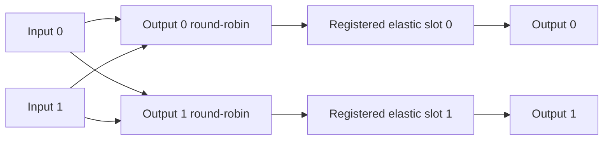

# multiport-packet-router-uvm

[English](README.md)

此專案以 SystemVerilog 實作 2 輸入、2 輸出的封包路由器，搭配可重用的 Accellera
UVM 2020.3.2 testbench。內容涵蓋 ready/valid、round-robin 仲裁、獨立預期結果檢查、
functional coverage、SVA 與刻意注入的 RTL 缺陷，供 ASIC/DV 面試準備。

## 從乾淨 checkout 重現

使用 Linux 或 WSL2 的 Ubuntu 24.04，以下指令需在 Linux shell 執行。
安全解壓縮需要 Python 3.12 以上，專案不需安裝 Python 第三方套件。

```sh
sudo apt-get update
sudo apt-get install -y --no-install-recommends build-essential git python3 perl ca-certificates autoconf flex bison libfl-dev z3
git clone https://github.com/ncusspm25/multiport-packet-router-uvm.git
cd multiport-packet-router-uvm
python3 scripts/bootstrap_tools.py --jobs 2
make verify JOBS=2
```

安裝腳本固定使用官方 **Verilator 5.054** 與 **UVM 2020.3.2**，核對版本與完整性，
並產生不進版控的 `.tools/env.mk`。最佳化版 simulator 在獨立目錄建置，系統原有工具
可繼續使用。首次建置 Verilator 與編譯 UVM 需要數分鐘。

WSL2 可將原始碼與 build 目錄放在 Linux 檔案系統，以降低 Windows 掛載目錄的 I/O
成本。也可指定獨立 build 目錄。

```sh
make verify BUILD_DIR="$HOME/.cache/router-build" JOBS=2
```

## Router 協定



- 每次成功 handshake 的一拍即為完整封包，`dest` 選擇 output 0 或 1。
- `DATA_W` 預設 32，RTL directed tests 涵蓋 1、8、16、32、64 bits。
- 每個輸出各有一組 round-robin arbiter 與一格 registered buffer。
- 仲裁優先權只在輸入成功接收時輪替。輸出 stall 時保持 valid 與 data，buffer 可在
  同一個 edge 送出舊封包並接收新封包。
- Forward latency 為一拍，不同目的地在 pipeline 填滿後各可每拍傳送一包。
- Source 必須保持 valid、data 與 destination，直到 handshake 成功。
- 同步 active-low reset 清除 buffer valid 與仲裁優先權。已接收但尚未送出的封包
  計入 reset-aborted，scoreboard 建立新的 reset epoch。
- 每個輸出依輸入接收順序檢查 FIFO 保序。兩個輸出各自受 backpressure 影響，沒有
  跨輸出的全域完成順序保證。

完整訊號與仲裁規則見 [architecture.md](docs/architecture.md)。

## 驗證架構

每個 source agent 含 packet sequencer、driver 與 monitor。Sink agent 含獨立設定的
ready responder 與 monitor，active/passive 模式控制是否建立 driver。Driver 在
falling edge 更新訊號，monitor 在 rising edge、RTL nonblocking update 之前取樣。

四個 analysis FIFO 依 cycle 對齊各 port 的觀察值。SystemVerilog reference model
依輸入 handshake 建立預期佇列，檢查輸出資料、順序、路由、封包守恆、reset abort
及 round-robin 仲裁，不讀取 DUT 內部狀態。另一份 Python FIFO oracle 會獨立重播
transfer CSV，逐次核對所有正向測試。

原生 covergroup 明確定義 route、contention grant、output stall、traffic 中 reset、
payload pattern 及 scenario bins。Scenario 完成還需觀察到對應的實際流量條件。
SVA 檢查輸入／輸出 stall stability、同步 reset 清除及 contention 時的唯一 grant。

## 指令與實測證據

| 指令 | 執行內容 |
| --- | --- |
| `make smoke` | 完整 UVM factory／phasing／objection 最小 smoke test |
| `make features` | 實跑 randomization、virtual interface 與原生 coverage API |
| `make directed DATA_W=32` | RTL 單埠、多埠、contention、backpressure 與 reset |
| `make test CASE=single SEED=1` | 單一 UVM case，包含 Python 獨立檢查 |
| `make test CASE=random SEED=17 N_PACKETS=512` | 固定 seed 的 constrained-random 流量與 ready |
| `make test CASE=all SEED=1` | 同一個 covergroup instance 執行全部七個 scenarios |
| `make test CASE=stress SEED=1` | 每個輸入至少 5,000 包，至少 10,000 clock cycles |
| `make regression` | 正向測試、同 seed 重播、passive agent 與預期負向測試 |
| `make coverage reports` | 合併原生 coverage，產生實測報告 |
| `make verify` | 依順序執行完整驗收流程 |

`CASE` 支援 `single`、`simultaneous`、`contention`、`backpressure`、`reset`、
`random`、`stress`、`all` 及預期負向的 `protocol_negative`。
`make test CASE=protocol_negative` 會刻意觸發 protocol assertion。請用
`make regression` 判定這個失敗是否符合預期。

Regression 明列 seeds 1、17、123，會重跑 seed 17，並比對包含 cycle 資訊的
transfer trace SHA-256。驗收同時要求 process 成功結束、完成標記、UVM severity
summary、JSON report、Python replay 及原生 coverage 檔案。

[模擬實測報告](reports/verification.md)、[coverage 報告](reports/coverage.md) 及
[機器可讀結果](reports/regression.json) 記錄實際執行內容。GitHub Actions 會從乾淨
checkout 執行同一套流程，並保存 logs、transfer traces 與 coverage artifacts。

## Mutation 測試

`scripts/make_mutants.py` 在 build 目錄產生六種 RTL 缺陷版本，正式綜合來源為
`rtl/packet_router.sv`。Manifest 記錄每項修改與 SHA-256。Test-only wrapper 以
`+MUTATION=<id>` 選擇版本，其無缺陷路徑必須重現正式 RTL 的 transfer trace。

| 缺陷 | 必須觸發的檢查 |
| --- | --- |
| 遺失已接收封包 | `SB_LOSS` |
| 重複送出封包 | `SB_DUPLICATE` |
| 翻轉一個 data bit | `SB_CORRUPTION_OR_ORDER` |
| 反向 destination routing | `SB_ROUTING` |
| 將 round-robin 改為固定優先權 | `SB_ARBITRATION` |
| Stall 時改變輸出資料 | `SVA_OUTPUT_STABLE` |
| Source 在 stall 時改變輸入資料 | `SVA_INPUT_STABLE` |

Python oracle 也必須偵測 loss、duplication、corruption 與 routing mutation traces。
Protocol／assertion 的預期失敗會保留原始 log。

## 檔案與限制

`rtl/` 放可綜合 RTL。`tb/uvm/` 放 transaction、sequence、agents、reference model、
coverage、environment 與 test。`scripts/` 放固定版本工具鏈、regression、mutation
與報告工具。

[工具限制](docs/tool-limitations.md) 說明已驗證的 simulator 子集、two-state 模擬、
參數化驗證範圍及尚未執行的實體實作檢查。此專案為 single-clock、single-beat 的
教學 router。第三方來源與授權資訊見
[THIRD_PARTY_NOTICES.md](THIRD_PARTY_NOTICES.md)。
