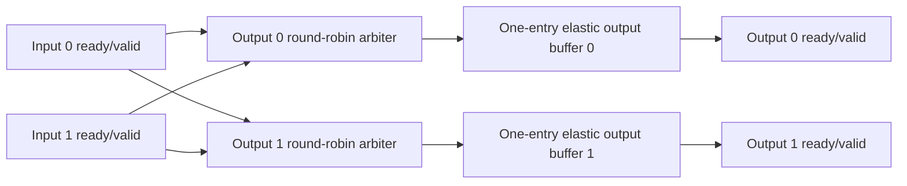

# Architecture and protocol contract

This project uses a fixed-length, single-beat packet. An input packet consists of
`data[DATA_W-1:0]` and a separate one-bit `dest`. Every rising edge with reset high,
`valid=1` and `ready=1` transfers exactly one complete packet. There are no hidden
SOP/EOP signals, headers, packet fragments, or multi-beat arbitration locks.

Each output independently arbitrates only between inputs whose destination equals
that output number. Priority starts at input 0 after reset and advances to the
other input only when a packet is accepted into that output buffer. When both
inputs continuously contend and space is available, accepted grants alternate.
An output stall does not advance its priority.

Each output has one registered slot. It may simultaneously deliver its old packet
and accept its next packet. Empty buffers have one-cycle forward latency and do
not bypass. Two independent destinations can each sustain one transfer per cycle.
The ready path is combinational, and there is no combinational output-valid or
output-data path from an input.

Sources must hold valid, data and destination while stalled. The router must hold
output valid and data while stalled. Deasserting valid before accepting a packet
is a source protocol violation. Every input routes to one output, so no accepted
packet may be duplicated into both buffers.

Reset is active low and synchronous to the rising clock edge. It clears buffer
valid bits and arbitration priority. Packets accepted before a reset and not yet
delivered are explicitly aborted. The scoreboard starts a new reset epoch and
does not classify these aborted packets as ordinary traffic loss. Handshakes are
counted only on rising edges with reset high.

Ordering is FIFO within each `(input, destination)` flow. Arbitration defines the
merge order of different inputs at one output. Different outputs make independent
progress, so there is no total completion order across different destinations.
